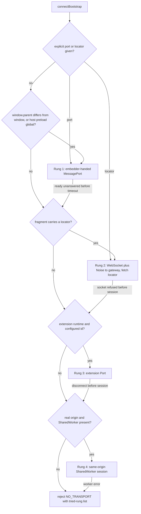

# Design: `@endo/ocapn-connect`, one entry point from sandboxed content to an OCapN bootstrap

Requested by kriskowal (liaison session, 2026-10-16). Job
`design-ocapn-bootstrap-package-20261016`.

Sandboxed or isolated content (the minion.town clip iframe, Familiar's renderer,
a web-extension page, a plain tab) needs OCapN capabilities, but each host offers
a different channel. This design proposes a small package with **one call**,
`connectBootstrap()`, that tries a fixed ladder of transports by feature
detection and returns a connected session and a bootstrap object. Client code
does not know which transport it got. The design builds on two existing records
and does not replace them:

- [ocapn-nonce-locator.md](ocapn-nonce-locator.md): the public OCapN bootstrap is
  a nonce locator, the daemon `FormulaIdentifier` is the Swiss number, and a miss
  is one generic failure.
- kriscendobot/minion.town#189 (`designs/clip-shell-framework.md` on
  `design/clip-iframe-embedding`): the shell frames `https://<id>.ocap.site/`
  with `sandbox="allow-scripts allow-same-origin"`; clips send
  `CORP: same-origin` and `COEP: require-corp`. kriscendobot/minion.town#88 adds a
  session locator carried in the URL fragment.

## 1. The answer to the maintainer's question, from a real browser

I ran a throwaway matrix in **headless Chromium 153.0.8010.12** (Playwright's
`chromium-1243` build driven by `playwright-core` 1.64.1). The setup was one
HTTPS server with a self-signed certificate. Three hosts, `shell.test`,
`clip.test` and `other.test`, were mapped to loopback with
`--host-resolver-rules`, so they behave as three distinct sites, the way
`minion.town` and `<id>.ocap.site` do. The shell framed the clip in every
combination of sandbox (`allow-scripts`, `allow-scripts allow-same-origin`, no
sandbox), clip headers (none, or `CORP: same-origin` + `COEP: require-corp`),
shell COEP (default, or `require-corp`) and clip CSP (none, or
`connect-src 'self'`). Cookies were pre-set on `clip.test` as `SameSite=None`
and `SameSite=Lax`. Firefox and WebKit were not available on this host, so
every row below is Chromium-only until the probe in section 6 runs.

**Opaque origin: `sandbox="allow-scripts"` without `allow-same-origin`, clip on a
distinct site.**

| Hypothesis from the brief | Chromium 153 result |
| --- | --- |
| Origin is opaque | **Confirmed.** `self.origin === "null"`. `isSecureContext` stays `true`. |
| Tag loads work but CORP `same-origin` blocks them | **Confirmed, and wider.** `` and classic `<script>` load with no CORP header but fail with `CORP: same-origin`. They **also fail with `CORP: same-site`**: an opaque origin is same-site with nothing. Only `cross-origin` CORP or no CORP passes. |
| Clip doc with `COEP: require-corp` | **Stricter than the brief.** The clip's own CORP-less images then fail too, because every own-host load is cross-origin to the opaque document. Only `CORP: cross-origin`, or CORS with a `crossorigin` attribute, loads. |
| `fetch`, module scripts, workers need CORS | **Confirmed.** `fetch` and `import()` to its own host fail without `Access-Control-Allow-Origin`. They succeed with `*` or `null` (credentials omitted). The server sees `Origin: null` and `Sec-Fetch-Site: cross-site`. `new Worker('/same-host.js')` and `new SharedWorker(...)` throw `SecurityError` even with CORS. A `blob:` Worker runs, with origin `null`. |
| `localStorage`, IndexedDB, cookies throw `SecurityError` | **Confirmed**, and `navigator.serviceWorker` throws too. `BroadcastChannel` **constructs** without error (cross-context delivery was not tested). |
| WebSocket to its own host connects, CSP applies | **Confirmed.** It connects and the server sees `Origin: null`. A clip CSP of `connect-src 'self'` **still admits the clip's own host** (`'self'` matches the document URL's origin, not the opaque origin) and blocks `other.test`. |
| Server sees `Origin: null` and **cookies do not ride along** | **Refuted for `SameSite=None` cookies.** The WebSocket handshake carried `sess=1` (the `SameSite=None` cookie) from the opaque frame. A credentialed `fetch` with `ACAO: null` + `ACAC: true` carried it too. The `SameSite=Lax` cookie was withheld, but it was also withheld from the same frame **with** `allow-same-origin`, because the top-level site is `shell.test`. So top-level-site rules decide which cookies are sent, not the opaque origin. This held with Chromium's default third-party-cookie setting. A browser that blocks third-party cookies (Safari, Firefox ETP, Chrome with 3PC blocked) is expected to drop them, but that is **unverified**. |
| `postMessage` works, `event.origin` useless | **Confirmed.** The parent saw `event.origin === "null"`. A `MessageChannel` port transferred into the frame round-tripped in every sandbox mode. |

**With `allow-scripts allow-same-origin`, clip on a distinct origin:** the frame
keeps `https://clip.test`. Assets, `fetch`, modules, workers, `SharedWorker`,
storage, `document.cookie` (only the `SameSite=None` cookie, as above) and the
service-worker container all work. Its `event.origin` is its real origin. It
**cannot** read `parent.document` (`SecurityError`).

**With `allow-scripts allow-same-origin`, content same-origin with the shell:**
the frame **read `window.parent.document`**, so it could remove its own sandbox.
This confirms the brief: the sandbox means something only on a distinct origin.

**COEP composition (bears on #189 § 3.2):**

- Shell COEP default, clip doc `CORP: same-origin` + `COEP: require-corp`: the
  frame loads and runs. This confirms #189's reading of Fetch § 3.7 for Chromium.
- Shell `COEP: require-corp`: the frame is **blocked** when the clip doc sends
  `CORP: same-origin` **or** `same-site`, in both sandbox modes. It loads only
  when the clip doc sends `CORP: cross-origin` (with `COEP: require-corp`).
  The frame's `load` event fires on the error page in every case, which shows
  again that the parent cannot detect refusal (#189 § 3.4).

**So what does "OCapN over the window message channel" mean?** It cannot mean
`window.postMessage` with origin checks: in the opaque case `event.origin` is
`"null"` for every sandboxed sender, so the origin identifies no one. It means
the embedder creates a `MessageChannel`, keeps `port1`, and transfers `port2`
into the frame **once**, addressed by `iframe.contentWindow` (never by origin).
The port is then a private, ordered, bidirectional byte-capable channel. Only the
holder of `port2` can use it, so **possession of the port is the identity**. OCapN
runs over that port as it would over a socket (section 3.2). This holds in every
sandbox mode measured, which is why the port is rung 1.

## 2. Authority model

- The **embedder** (the minion.town shell, Familiar's main process, an extension
  background, a host page) holds whatever real connection exists and decides
  what to hand down.
- Sandboxed content receives **exactly one** of: a `MessagePort`, or a nonce
  locator. It never gets ambient network authority from the package. The package
  does not read cookies, storage, or `document.referrer` to find authority, and
  never sends credentials (`credentials: 'omit'`; a WebSocket cannot opt out, so
  section 4 states that cookies must never be the authority).
- **Attenuation happens at the embedder.** In the default **terminating** mode
  the embedder runs the OCapN session over the port and exports an attenuated
  object as the port session's bootstrap. In the optional **piping** mode
  (section 2.1) it relays opaque bytes to the gateway and the content presents a
  locator end to end.

### 2.1 Terminating versus piping embedder

| | Terminating (default) | Piping |
| --- | --- | --- |
| What the embedder sees | Every message; holds the real session | Only Noise ciphertext; can cut the pipe |
| What content holds | A port whose bootstrap is the attenuated object | A port plus a locator |
| When to use | Shell is trusted with the content's authority (clip shell, Familiar) | Content's authority must be hidden from the embedder |

The embedder in piping mode gains no authority from relaying. It can still deny
service. Whether piping mode ships in v1 is Open question 3.

## 3. Transport ladder

Each rung has a **precondition** that is tested without side effects
(`typeof`, property presence, `self.origin`, configuration). Only then is a
**connection attempted**. A rung that fails before any OCapN byte is sent falls
through to the next rung. A rung that fails after the session started does not
fall through; the error is returned (section 5.2). Callers may override the
order or pin a single rung.



**Rung 1: embedder-handed port.** Applies to iframes, Familiar, popups that keep an
opener, and any host with a preload. Precondition:
`globalThis.parent !== globalThis` (also `opener`), or a host-injected
`globalThis[Symbol.for('ocapn-connect.port')]` provider (Familiar preload).
Handshake: the content posts `{ type: 'ocapn-connect/ready', v: 1 }` to its parent
with `targetOrigin '*'`. The message carries no data, so sending it is harmless.
The embedder **must** check
`event.source === iframe.contentWindow` (never `event.origin`). It then replies
with `{ type: 'ocapn-connect/port', v: 1 }` and a transfer list containing `port2`.
In the real-origin case it addresses `postMessage` with the clip's real origin;
in the opaque case it uses `'*'`. The content accepts the **first** port from
`event.source === parent` and ignores later ones. Reconnect is the same
handshake again; the embedder decides whether to answer. Timeout (default 2 s)
falls through.

**Rung 2: WebSocket plus Noise to the gateway, presenting a nonce locator.**
Precondition: a locator was given explicitly, or the URL fragment parses as
#88's grammar (`#?v=1&p=<nonce>`, not yet normative). Also `typeof WebSocket`.
The package reads `location.hash` and **immediately** scrubs it with
`history.replaceState` before doing anything else, per #189 § 3.4. It dials the
sturdyref's peer location over `@endo/ocapn`'s WebSocket+Noise netlayer, opens a
session, and calls protocol bootstrap `fetch(swissNum)`. The precondition
cannot test `connect-src` in advance: a CSP-blocked socket only fires `error`
(observed). That `error` arrives before any byte, so it falls through. Works from
an opaque origin as long as the gateway is the frame's own host or is listed in
`connect-src` (observed).

**Rung 3: web-extension port.** Precondition:
`globalThis.chrome?.runtime?.connect ?? globalThis.browser?.runtime?.connect`
plus a configured extension id for page-to-extension use. Content scripts and
extension pages call `runtime.connect()`. Web pages call
`runtime.connect(extensionId)`, which needs the extension's
`externally_connectable` (Chromium; Firefox support is unverified). The
background script terminates or pipes as in section 2.1. It may reach a local
Endo daemon through **native messaging** (`runtime.connectNative`, stdio JSON
framing). Extension `Port`s carry JSON-serializable values only, not
transferables, so OCapN frames ride as base64 strings. **All of rung 3 is
unverified** platform knowledge.

**Rung 4: same-origin `SharedWorker`.** Precondition: `self.origin !== 'null'` and
`typeof SharedWorker === 'function'` (it throws in an opaque frame; observed).
The worker holds the one real WebSocket session (it is itself a rung-2 client).
Each tab gets a `MessagePort` from `onconnect` and a terminating session over it,
so tabs on one origin share one gateway connection. **`BroadcastChannel` is not a
rung.** It cannot transfer a `MessagePort` (structured clone only) and it is
keyed to the origin, so it fails in exactly the opaque case. At most it is a
rendezvous hint, and v1 does not use it.

Rejected rungs: `window.name` and URL query or path (they leak to logs and history, #189 §
3.4); `localStorage` handoff (throws when opaque, and is a persistent bearer
store); `document.cookie` (not an object capability; rides on requests the
content did not choose).

## 4. The nonce locator

**Shape.** No new protocol record. The nonce locator **is** an OCapN
`<ocapn-sturdyref peer swiss-num>` whose Swiss number is the canonical ASCII
`FormulaIdentifier`, exactly as in [ocapn-nonce-locator.md](ocapn-nonce-locator.md).
Its URI form is `ocapn://<designator>.<transport>/s/<swiss>`. When content
receives it through a fragment it is wrapped in #88's envelope; over a port it
travels as the in-band record.

**Single use and expiry are behavior of the designated object, not of the
locator.** The formula locator stays a pure lookup, so
`makeFormulaNonceLocator` does not change. To hand sandboxed content a
**one-shot** introduction, the gateway (the embedder's agent) makes a fresh
**introducer** formula and gives out its identifier. The introducer has one
method, `redeem()`. The first call returns the attenuated target and retires
the introducer. A `cancelled` `Promise<never>` held by the minting party (a
deadline timer, or the shell's per-tab lifetime) retires it unredeemed. Once it
is retired, its formula is collected, so `fetch` of that identifier is the same
generic miss as any other unknown identifier. A **durable** locator (no
introducer) is the plain formula sturdyref and is revoked the usual way, by
designating a revocable facet and revoking it. Whether a daemon introducer
formula type already exists, or must be added in `@endo/daemon`, is Open
question 4.

**Minting and delivery.** The embedder asks its own agent to mint an introducer
for an attenuated facet, then delivers the identifier by the narrowest channel
available, in this order:

1. over an already-established port, where no URL is involved;
2. in the URL fragment of a top-level `noopener` link (the only carrier when no
   port can exist);
3. never in a path, query, `window.name`, storage, log or `Referer`.

**What an attacker who sees it can and cannot do.**

- **Can**, before redemption and before expiry: race the rightful content, redeem
  it, and obtain the attenuated target (it is a bearer capability). The rightful
  client then gets the generic miss and reports `LOCATOR_SPENT`, so the theft is
  **detected**, though not prevented.
- **Can**, for a durable locator: use it until it is revoked.
- **Cannot**: learn anything from a miss (malformed, spent, expired and unknown
  look the same); derive any other formula identifier (256-bit unguessable);
  widen the target (attenuation by designation); obtain the daemon bootstrap, a
  host or a gateway; or use the clip's cookies for authority. Cookies reach the
  gateway (section 1) but grant nothing, because Noise identity and cookies are
  not authority, only the Swiss number is.

## 5. Package surface

### 5.1 Where it lives and what it is called

Propose **`@endo/ocapn-connect`**, a new package in the Endo monorepo. It is
developed on the `endojs/endo-but-for-bots` fork and carried to `endojs/endo`
only through the ferry, with maintainer review. It needs `@endo/ocapn` (sessions,
codecs, netlayer interface), `@endo/ocapn-noise`, and `@endo/eventual-send`.
`@endo/gateway` remains the server side (it already terminates OCapN-over-Noise
WebSockets). The name has no `exo-` prefix: the package exports no passable
interface over CapTP; it is a client connector. Its export conditions select
platform code without detection: `browser`, `worker`, `electron`, `node`
(`node` exposes only rung 2 plus explicit ports). Subpaths: `.` (content side),
`./embedder` (shell side), `./transports/*` (single rungs, for pinning). The
alternative is minion.town-local; see Open question 1.

### 5.2 Content side

```js
import { connectBootstrap } from '@endo/ocapn-connect';

const { bootstrap, session, transport } = await connectBootstrap({
  cancelled,            // Promise<never>; rejecting it tears everything down
  port,                 // optional explicit MessagePort (rung 1, no detection)
  locator,              // optional explicit sturdyref (rung 2, no detection)
  rungs,                // optional order override: ['port', 'websocket']
  codec: 'cbor',        // 'cbor' | 'syrup'; must match the gateway route
  timeoutMs: 2000,      // per-rung precondition-to-session budget
});
// bootstrap: a presence. Port rungs: the embedder's exported object.
//            Locator rungs: the result of fetch, or of redeem() for introducers.
// session.closed: Promise<{ reason }>; resolves once, never rejects.
// transport: 'port' | 'websocket' | 'extension' | 'shared-worker' (diagnostics only)
```

**Errors** (a rejected promise whose error `code` is one of): `NO_TRANSPORT`
(lists the rungs tried and why, never a secret); `LOCATOR_MISS` (the generic
fetch miss); `LOCATOR_SPENT` (an introducer fetched but no longer redeemable);
`TIMEOUT`; `CANCELLED`; `TRANSPORT_CLOSED`. No message ever contains a locator,
a Swiss number, or a port's origin.

**No transparent reconnection.** OCapN session severance breaks every presence
from that session. The package reports it on `session.closed` and does not
silently redial, which would produce new presences under the old names. The
caller calls `connectBootstrap` again: a durable locator re-fetches, a port rung
re-runs the `ready` handshake, and a spent introducer cannot reconnect by
design.

### 5.3 Embedder side

```js
import { offerBootstrap } from '@endo/ocapn-connect/embedder';

offerBootstrap({
  frame: iframe,          // or a Window, Electron webContents, extension Port
  bootstrap: attenuated,  // terminating mode: what the content's bootstrap is
  // pipe: gatewayLocation // piping mode instead of `bootstrap` (Open question 3)
  targetOrigin,           // the clip's real origin, or '*' when opaque
  cancelled,              // tears down the port session and refuses re-offers
});
```

### 5.4 Composition with Endo

Each rung yields a byte duplex that is wrapped as an `@endo/ocapn` `NetLayer` /
`Connection` (the `client/types.js` interface), so sessions, codecs, GC and
promise pipelining are the ordinary OCapN client's. Two netlayers are new:

- a **port netlayer** (`makePortNetlayer`), with `ArrayBuffer` frames
  transferred, not copied;
- a **browser WebSocket+Noise netlayer**. Endo `llm` has a Node-`ws`
  WebSocket netlayer, and the Noise-over-WS daemon transport is
  endojs/endo-but-for-bots#684 (open draft).

The port netlayer authenticates nothing, because possession of the port is the
authentication. It therefore omits `verifyPeerLocation`, and the session's
locations are ephemeral. Both netlayers belong in `@endo/ocapn` if the maintainer
prefers that, rather than in the connector (Open question 2).
`@endo/capn-web` already ships a MessagePort transport, but it speaks Cap'n Web,
not OCapN, so it is not reused for the session. The existing CapTP
(`@endo/captp`) paths in Familiar are not affected; Open question 5 asks whether
a `protocol: 'captp'` option is wanted for them.

## 6. Interaction with minion.town #189

1. **No conflict in the chosen posture.** #189 frames `<id>.ocap.site` with
   `allow-scripts allow-same-origin`. In Chromium that keeps the clip's origin,
   loads its `CORP: same-origin` assets, and loads the frame under the shell's
   default COEP. Rung 1 works with a real-origin `targetOrigin`.
2. **Conflict to flag: rung 2 versus the clip CSP.** The clip CSP is
   `connect-src 'self'`, so a clip can open a socket only to its own
   `<id>.ocap.site` host. For rung 2 either the gateway serves
   `/.well-known/ocapn-{cbor,syrup}-np` on every `<id>.ocap.site` host, or the
   clip CSP names the gateway host. Rung 1 needs neither, which is a reason to
   prefer it for framed clips (Open question 6).
3. **Conflict to flag: future shell `COEP: require-corp`.** Observed in Chromium:
   it blocks framing a clip whose document sends `CORP: same-origin` (or
   `same-site`). #189 § 3.2 already makes that change carry a browser
   obligation; this evidence says the obligation fails today. Adopting shell
   COEP would require the clip **document** (not its subresources) to send
   `CORP: cross-origin`.
4. **The opaque alternative (#189 § 3.6) is costed by evidence.** Dropping
   `allow-same-origin` breaks every clip asset under `CORP: same-origin`, and
   under the clip's `COEP: require-corp` it breaks even CORP-less assets. It
   also removes storage and workers. The port rung would still work, so an
   opaque clip is feasible only if clips are served `CORP: cross-origin` with
   CORS.
5. **Sibling clips are same-site.** `ocap.site` is not on the Public Suffix List
   (checked 2026-10-16), so all `<id>.ocap.site` origins share one site.
   `SameSite` cookies and `CORP: same-site` do not separate clips. Neither is
   used here as authority, but a future change must not treat "same-site" as
   "same clip".
6. **Locator invariants are compatible and simpler with ports.** #189 § 3.4
   carries the #88 locator in the frame `src` fragment. With rung 1 the shell
   sends the locator (piping) or nothing (terminating) over the port, so a framed
   clip's `src` never needs a fragment. The fragment remains the only carrier for
   the top-level "Open in new tab" link.

## 7. Ownership map

| Boundary | Mechanism | Policy | Durable state | Lifecycle / commit | Value crossing |
| --- | --- | --- | --- | --- | --- |
| Content to embedder (port) | `@endo/ocapn-connect` port netlayer | Embedder: what to export, whether to answer `ready` | None | Embedder's `cancelled` ends the port session | `MessagePort`; OCapN frames |
| Content to gateway (WS) | `@endo/ocapn` WS+Noise netlayer | Gateway: route, codec, miss bounds | None in the connector | Session severance; caller reconnects | Sturdyref; Swiss number in `fetch` |
| Gateway to daemon | `makeFormulaNonceLocator` | Daemon formula graph | Formula table | Daemon `provide` / collection | `FormulaIdentifier` |
| Embedder to its agent (minting) | Introducer formula (Open question 4) | Embedder: target facet, deadline | Introducer formula until spent | Minting party's `cancelled`; first `redeem` | Attenuated facet; introducer id |

Who owns persistent state: only the daemon (formulas); the connector is
stateless. Who decides commit or discard: the embedder (port lifetime,
introducer deadline), never the content. Who owns restart and replay: the
caller of `connectBootstrap`; the package never replays. Execution
classification (which rung ran) is the connector's, and it is reported only as
diagnostics. Naming check: the package returns a **session** and a
**bootstrap**, not a "gateway"; the gateway is the server role.

## 8. Verification plan

**Done in this job (Chromium 153 only):** section 1. The harness is about 150
lines: a Node HTTPS server with `ws`, routes with configurable
`CORP`/`COEP`/`CSP`/CORS headers, a shell page that frames by query string and
transfers a `MessageChannel` port, and a frame script that runs each probe and
returns results through both `postMessage` and the port. It is not committed;
the probe below rebuilds it as a reusable fixture.

**Proposed probe job** (for the liaison to post; a researcher job, no PR):

> `probe-ocapn-sandbox-transport-matrix`, role `researcher`. Re-run the matrix in
> `designs/ocapn-bootstrap-package.md` § 1 under **Chromium, Firefox and WebKit**
> (Playwright), headless and headed. Use three distinct registrable sites over HTTPS
> (a self-signed CA trusted by each engine, or loopback names mapped per engine).
> Axes: sandbox {none, `allow-scripts`, `allow-scripts allow-same-origin`, same-
> origin content with both tokens}; clip doc {plain, `CORP: same-origin|same-site|
> cross-origin` × `COEP: require-corp`}; shell COEP {default, `require-corp`}; clip
> CSP {none, `connect-src 'self'`}; third-party cookies {default, blocked}.
> Probes: ``/`<script>` under each CORP; `fetch` with CORS {none, `*`, `null`}
> × credentials {omit, include+ACAC}; `import()`; `Worker` (URL and `blob:`);
> `SharedWorker`; `BroadcastChannel` **cross-context delivery** between an opaque
> frame and a top-level same-host page; `localStorage`/IndexedDB/`document.cookie`/
> `serviceWorker`; WebSocket to own host and to a third host (record `Origin`
> and `Cookie` seen by the server for `SameSite=None|Lax|Strict`); parent
> `event.origin`; `MessageChannel` port transfer and `ArrayBuffer` transfer over
> it; whether the frame's `load` fires on a COEP/CORP refusal. Separately, if
> feasible: a minimal unpacked extension (content script and web page to background
> via `runtime.connect`, `externally_connectable` from a page, native messaging
> to a stub host) in Chromium and Firefox; and an Electron `MessagePortMain` to
> renderer port handoff (Familiar's shape). Deliver one table per engine, with
> each cell marked as observed or as not runnable and why, and flag every
> divergence from the Chromium column in § 1.

## Open questions

1. **Where should the package live, and under what name?** Recommendation:
   `@endo/ocapn-connect` in the Endo monorepo, developed on the
   endo-but-for-bots fork and ferried with maintainer review. It is not
   minion.town-specific, and Familiar and the extension rungs need it outside
   the town.
2. **Should the port and browser WebSocket+Noise netlayers live in `@endo/ocapn`
   itself or in the connector?** Recommendation: in `@endo/ocapn`, beside the
   existing WebSocket netlayer, so the connector holds only detection and the
   handshake.
3. **Does piping mode (section 2.1) ship in v1, or only terminating mode?**
   Recommendation: terminating only in v1. The clip shell and Familiar are
   trusted with what they hand down. Add piping when a concrete untrusted-
   embedder host appears.
4. **Does `@endo/daemon` already have a formula type that can act as a one-shot,
   deadline-bound introducer, or does one need to be added?** Recommendation:
   add a small `introducer` formula (target id plus deadline, retired on first
   `redeem` or on `cancelled`) rather than teaching the nonce locator about
   single use. That keeps [ocapn-nonce-locator.md](ocapn-nonce-locator.md)
   unchanged.
5. **Should the connector also speak `@endo/captp` (a `protocol: 'captp'`
   option) for Familiar's existing CapTP paths?** Recommendation: no. Keep the
   connector OCapN-only, and move Familiar to OCapN-over-port when it adopts the
   connector.
6. **For framed clips, should the town rely on rung 1 (shell-handed port) and
   leave the clip CSP at `connect-src 'self'`, or serve the OCapN well-known
   routes on every `<id>.ocap.site` host so rung 2 also works inside the frame?**
   Recommendation: rung 1 for framed clips. Serve the per-clip-host routes only
   for the top-level "Open in new tab" case, which has no port. Decide this
   together with #88's hand-off increment.
7. **Should the shell ever adopt `COEP: require-corp`, given that in Chromium it
   blocks framing clips whose document sends `CORP: same-origin`?**
   Recommendation: no, not while clip documents send `CORP: same-origin`. If
   cross-origin isolation of the shell becomes necessary, change the clip
   **document** response alone to `CORP: cross-origin`, after the section 8
   probe confirms the behavior in Firefox and WebKit.
