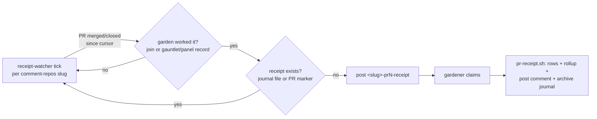

# Automated PR completion receipts

| Created | 2026-09-05 |
| Author  | gardener (job `design-pr-completion-receipts`) |
| Status  | Proposed — carries open questions (§ Open questions); landed on `main2` and mirrored to a review PR per CLAUDE.md § Conventions carve-out |

Every pull request the garden works on ends — merged or closed — and today that
ending leaves no ledger. The maintainer asked (kriskowal, 2026-09-05) for an
automated **completion receipt** emitted for **every** PR the garden finishes,
merged **or** closed, posted as a PR comment **and** archived in the journal:
per-engagement `model / tokens / harness / role / notional cost / calibrated
cost`, plus one per-PR **measurement rollup** (token cost, wall-clock, job
duration, words of human feedback, review/gauntlet counts, quality-bar class).
The original per-PR *heuristic cost of maintainer review* was retired
2026-11-05 (§ Human-effort estimation retired).

The garden already owns nearly every primitive this needs. This is a
**composition** design plus **one new deterministic watcher** — not new infrastructure. It reuses the true-cost join
(`cost-by-pr.sh`), the per-engagement usage ledger (`usage/<base>.jsonl`), the
reputation events (`reputation/events/<base>.md`), the same maintainer-cleared
watch set the comment/CI watchers ride, and the same identity-pinned `gh` wrapper
they post through.

## What already exists (build on, do not reinvent)

- **`scripts/jobs/cost-by-pr.sh`** — the base→PR join is the hard part and it is
  solved. Two deterministic edges (authoritative `jobs/index/<hash>` directive
  identity, then PR-number-in-basename validated against the real PR set) map a
  job base to its PR, with measured join coverage and an explicit
  `__UNATTRIBUTED__` bucket. It prices on **two bases already**: NOTIONAL (the
  usage ledger's list-price `total_cost_usd`, ~8.7× high on a flat subscription)
  and **TRUE-COST** (each reputation event's capped-proxy wallclock ×
  `reputation/rate-card.md`). Today it rolls up to **merged** PRs only.
- **`usage/<base>.jsonl`** — one JSON line per engagement, carrying
  `model, provider, role, input/output/cache_creation/cache_read tokens,
  num_turns, elapsed_s, total_cost_usd (notional), host, outcome, ts`. This is
  the richest per-engagement source and already the one `cost-by-pr.sh` parses.
- **`reputation/events/<base>.md`** — the final per-base record carrying the
  **calibrated** cost: `estimated_dollars` (wallclock proxy × rate card) or
  `aggregate_dollars` (metered providers), plus `provider, model,
  thoughtfulness, duration_secs, cost_source`.
- **`reputation/rate-card.md`** — journal data that **outranks** the tracked seed;
  a rate correction needs no deploy. The receipt's calibrated basis and the
  maintainer-rate constant follow this same journal-data-outranks-seed pattern.
- **`panel-runs/<repo-slug>-<pr>/*.md`** and **`jobs/gauntlet-archived/*.md`** —
  per-PR **machine** review records (`rounds`, `must_fix_total`, `iteration`,
  `resumes`). These are the garden's *own automated* review; they are **machine**
  cost, not maintainer attention, and inform the receipt as context, not as the
  maintainer-review figure.
- **Comment-posting** — `panel.sh` and the fixer path already post PR comments
  through the fleet's identity-pinned `gh` wrapper, only on the
  maintainer-authorized `comment-repos/` set. The receipt reuses that path and
  **widens commenting to nothing**.

## The receipt

Two parts: a table of **per-engagement rows** and a per-PR **measurement
rollup**. Legible as a plain PR comment, and distilled when a PR has many
engagements (§ Size discipline), reusing `panel.sh`'s foreperson-distillation
precedent for GitHub's ~65 KB body limit.

### Per-engagement rows

One row per engagement that joined to this PR. An "engagement" is one
`usage/<base>.jsonl` result row (the ledger's own boundary — one
`$GARDEN_JOB_HANDLER` invocation). Fields:

| Field | Source | Notes |
| --- | --- | --- |
| **role** | `usage` row `role` | builder, designer, fixer, weaver, gardener, a juror seat, … |
| **harness** | `usage`/`reputation` `provider` → agent-bin map | `anthropic`→`claude`, `openai`→`codex`, `moonshot`→`kimi`, `fireworks`→`fireworks`, `openrouter`→`openrouter`, `ollama-cloud`→`ollama`, `local`→`local`. This is the garden's `agent_bin`/worker-kind axis. |
| **model** | `usage` row `model` | resolved id, e.g. `claude-opus-4-8`, `kimi-k3`. |
| **tokens** | `usage` row | billable = `input + output + cache_creation` (the `usage-meter.sh` definition; `cache_read` shown parenthetically, excluded from billable). |
| **notional $** | `usage` row `total_cost_usd` | list-price; header-flagged as ~8.7× high on a flat plan. |
| **calibrated $** | `reputation` event `estimated_dollars` / `aggregate_dollars` | the garden's true-cost basis. Per-**base**, so when a base has several engagement rows the calibrated figure is attributed to the base and shown once on the base's summary line (a `∑` row), not duplicated per engagement. |

Rows group by base (a base may span requeues/hosts/roles). The comment shows a
per-base subtotal and a PR grand total for tokens, notional, and calibrated.

### The per-PR rollup (measurements only)

Raw numbers for postmortem analysis — estimating the marginal reduction in human
cost per marginal token spend at a fixed quality bar — never an estimate of human
cost. Rendered as a short list in the comment, carried in the archive frontmatter,
and appended as one JSON row to `receipts/rollup.jsonl` (§ Journal archive layout):

- **Token cost** — the calibrated (true-cost) dollars, with its basis stated; the
  notional figure alongside; billable tokens and **tokens by model**.
- **Wall-clock** — first claim of any job for the PR (earliest engagement start,
  `ts − elapsed_s` over the joined `usage/<base>.jsonl` rows) to merge/close.
- **Job duration** — Σ `elapsed_s` over those rows; with the job (base) and
  engagement counts.
- **Words of human feedback** — WORDS (whitespace-separated tokens, plain code;
  no LLM reads a body) across review bodies, inline review comments and issue
  comments by human authors, split **maintainer** (journal
  `maintainers/allowlist`) vs **other**, and per author. The human-author filter
  drops the fleet bot, `config/fork-owners` logins, `Copilot`, and `*[bot]`.
- **Review counts** — human reviews, inline threads (root comments), comments;
  verdict counts and the ordered `CHANGES_REQUESTED`/`APPROVED` sequence.
- **Gauntlet counts** — panel runs and Σ panel rounds (`panel-runs/`), and fix
  rounds (joined bases whose role is fixer/americanizer/deslopper).
- **Quality-bar class** — an ordered class for the target repo from the tracked
  seed `scripts/jobs/quality-bar-defaults.tsv` (`endojs/endo` 1 highest >
  `endojs/endo-but-for-bots` 2 high > `kriscendobot/garden`,
  `kriscendobot/minion.town` 3 low), outranked by a journal `config/quality-bar`
  in the same format; any other repo is `unknown`.

No quality score and no human-dollar figure is computed.

### Example shape

```markdown
## 🧾 Garden completion receipt — endojs/endo-but-for-bots#1075 (closed, not merged)

Completed 2026-08-30. 4 engagements across 2 bases. Basis: calibrated = capped
proxy-wallclock × reputation/rate-card.md (true cost); notional = usage-ledger
list price (~8.7× high on a flat subscription).

| base | role | harness | model | tokens (billable) | notional $ | calibrated $ |
|---|---|---|---|---|---|---|
| build-…-1075 | builder | claude | claude-opus-4-8 | 143 900 | 5.04 | — |
| ″ (∑ base) | | | | 143 900 | 5.04 | **0.83** |
| …-pr1075-gauntlet-panel-1 | gardener | claude | claude-opus-4-8 | 39 570 | 0.69 | 0.11 |
| … | | | | | | |
| **PR total** | | | | **207 300** | **6.42** | **1.07** |

**Rollup (measurements, no human-cost estimate):**

- Token cost: **$1.07 calibrated** (notional $6.42); 207300 billable tokens.
- Wall-clock (first claim 2026-08-28T09:10:00Z → 2026-08-30T14:22:10Z): 53.2 h. Job duration Σ: 2.4 h over 2 job(s), 4 engagement(s).
- Human feedback: **212 word(s)** (maintainer 212, other 0); 2 review(s), 0 inline thread(s), 1 comment(s).
- Verdicts: 1 CHANGES_REQUESTED, 0 APPROVED (sequence `CHANGES_REQUESTED`).
- Quality bar: `high` (rank 2). Gauntlet: 1 panel run(s), 6 panel round(s), 0 fix round(s).

<sub>Receipt generated deterministically from the journal usage + reputation
ledgers and the PR's human review threads. Archived at
`receipts/endojs-endo-but-for-bots/2026/08/pr1075.md`.</sub>
<!-- garden-receipt: endojs/endo-but-for-bots#1075 -->
```

The trailing `<!-- garden-receipt: <repo>#<n> -->` marker is the **idempotency
key** (§ Idempotency).

### Closed-without-merge cost outcome

A close event alone does not establish that the work failed. Every closed receipt
therefore carries `closed_outcome`, with one of four values:

| Value | Evidence required | Cost interpretation |
| --- | --- | --- |
| `roll-forward` | A closing/successor citation shows that a later attempt repeated or rebuilt substantially the same approach, and records no finding from this attempt that changed the successor. | This PR's cost bought no distinct information and rolls into the successor's delivery cost. |
| `productive-redirect` | The later successful PR explicitly cites this attempt (or the closing record links them), identifies a finding learned here, **and** its implementation/design differs materially in response. | The cost bought information; report it as unsuccessful delivery but productive discovery. |
| `administrative-continuation` | The same effective change moved to another PR/repository solely because of base deletion, an unreopenable force-push, mirror/ferry mechanics, or another documented administrative reason. | Neither a design failure nor a redirect. Keep the receipt with the lineage, without calling it failed work. |
| `unresolved` | The closing reason, an explicit successor link, or evidence of material difference is missing. | No attribution may be inferred. This is the generator default. |

The generator accepts `--closed-outcome`, `--outcome-evidence`, `--outcome-note`,
and optional `--successor` for a researched backfill. Every non-`unresolved`
classification requires both a durable GitHub evidence URL and an explanatory note;
the generator rejects an unsupported label. It never reads prose and guesses. The
receipt archives those fields and renders a qualitative section next to the numeric
cost. Reclassification uses `--force` with new evidence.

This test intentionally distinguishes *material redirection* from merely moving the
same patch. A successor citation by itself is not productive learning: same-patch
retries are `roll-forward`, while branch/mirror-only moves are
`administrative-continuation`.

## Human-effort estimation retired

Receipts through 2026-11-05 carried a *maintainer-review-effort* (MRE) section:
estimated minutes `M = S·a + C·b + L/r` priced at an hourly rate `H`, and a ratio
to machine cost. It was retired at the maintainer's direction (kriskowal,
2026-11-05): tokens already cost far less than human review, and the
human-dollar heuristic was uncalibrated — its constants and rate were invented,
not measured — so it asserted a precision it did not have. Receipts now record
only measurements (§ The per-PR rollup). Older archived receipts keep their MRE
section unchanged; their new rollup fields are backfilled into
`receipts/rollup.jsonl` with `pr-receipt.sh --backfill-rollup`, which never
rewrites an archive.

## The trigger: a completion watcher

A new **deterministic, no-`claude -p`** producer, `receipt-watcher.sh`, modeled
exactly on `ci-watcher.sh` (which watches CI status) — this one watches **PR
terminal state**. Per tick, per watched repo:

```
enumerate the repo's OWN PRs that reached a terminal state (merged OR closed)
  since a durable journal cursor  (authoritative paginated REST, never a page cap)
    → keep only PRs the garden actually worked (≥1 base joins to this PR via the
       cost-by-pr.sh join, OR a jobs/gauntlet-archived / panel-runs record names it)
    → skip any PR that already has a receipt (journal receipt file exists, OR the
       PR body already carries the <!-- garden-receipt: repo#N --> marker)
    → otherwise post exactly one `<slug>-pr<N>-receipt` job, idempotent by basename
```

A gardener then claims `<slug>-pr<N>-receipt` and runs the **receipt generator**
(a `scripts/jobs/pr-receipt.sh`, plain code): build the rows from the ledgers,
compute the rollup, render the comment, post it via the identity-pinned `gh` wrapper,
and write the journal archive — all in one idempotent pass.

**Why a claimed job, not all-in-watcher.** The join, the `gh api` review reads,
and the comment post are non-trivial and must not block the watcher tick; the
watcher stays a cheap deterministic detector (like ci-watcher minting a
shepherd), and the receipt work is a normal fresh-budget claimable job. The
generator itself runs **no LLM** — it is deterministic — but it lives as a job so
retries and the board's CAS idempotency apply.

**Arming and monitoring safety.** `receipt-watcher.sh` is a leader-only
singleton template unit `garden-receipt-watcher@<slug>`, armed by
`repo-watcher.sh`'s reconcile against the **same `comment-repos/` set** the
comment and CI watchers use (add one line:
`reconcile_set comment-repos garden-receipt-watcher`). It reads only PR **state
and authorship/metadata** and the garden's **own** journal ledgers — never
external comment *bodies* into an LLM (the generator reads human comment bodies
only to **count and measure length**, deterministically, never feeding them to a
model). So it is injection-safe by construction, like ci-watcher, and posts only
on the already-authorized set — no widening of the monitoring surface
(CLAUDE.md § Monitoring safety constraint).



## Journal archive layout

```
receipts/<repo-slug>/<YYYY>/<MM>/pr<N>.md
```

e.g. `receipts/endojs-endo-but-for-bots/2026/08/pr1075.md`. Categorized by
**repository** (top dir), **date** (year/month of completion), and **PR number**
(filename) as asked. `pr<N>` is unique within a repo (a PR completes once), so no
day-level directory is needed for uniqueness; the full ISO completion date lives
in the file's frontmatter. The directory tree alone is browsable, so no separate
index/manifest is required.

Historical jobs from before watcher identities sometimes have no deterministic join,
or name an earlier PR while doing work on its reconstruction. The journal file
`receipts/base-pr-overrides.tsv` records the researched correction as
`base<TAB>owner/repo#N<TAB>evidence-URL`. `cost-by-pr.sh` treats this as the strongest
edge; the third evidence column is only for auditability and is ignored by the parser.

Historical jobs from before watcher identities sometimes have no deterministic join,
or name an earlier PR while doing work on its reconstruction. The journal file
`receipts/base-pr-overrides.tsv` records the researched correction as
`base<TAB>owner/repo#N<TAB>evidence-URL`. `cost-by-pr.sh` treats this as the strongest
edge; the third evidence column is for auditability and is ignored by the parser.

The archived file is the **full** receipt (frontmatter + the complete,
un-distilled table even when the posted comment was distilled for size):

```markdown
---
repo: endojs/endo-but-for-bots
pr: 1075
completed_at: 2026-08-30T14:22:10Z
disposition: closed          # merged | closed
posted_comment_url: https://github.com/…/pull/1075#issuecomment-…
engagements: 4
bases: [build-…, …-pr1075-gauntlet-…]
tokens_billable: 207300
notional_usd: 6.42
calibrated_usd: 1.07
job_duration_s: 8640
human_words: 212
quality_bar_class: high
quality_bar_rank: 2
rollup_schema: 1
---
<full receipt markdown>
```

Alongside each archive the generator appends one JSON object to
**`receipts/rollup.jsonl`** (append-only, `schema: 1`) with the same rollup
fields, for bulk analysis. A `--force` regeneration or a backfill appends a new
row rather than editing an old one; readers take the latest row per
`(repo, pr)`. `--backfill-rollup` appends only when no `schema: 1` row exists for
the PR.

## Idempotency and retry

A PR completes once, so this is simpler than the recurring-job cases — the risk
is a **crashed retry double-posting**, not a recurring re-fire. Three guards, any
one sufficient:

1. **Journal receipt file** — if `receipts/<slug>/<YYYY>/<MM>/pr<N>.md` already
   exists on `journal2`, the generator is a no-op (re-posts nothing).
2. **PR-body / comment marker** — before posting, the generator lists the PR's
   comments for the `<!-- garden-receipt: <repo>#<N> -->` marker; if present it
   skips the post and only ensures the archive exists (heals a
   posted-but-not-archived crash, and vice-versa).
3. **Watcher pre-check** — the watcher skips minting a `-receipt` job for a PR
   that already satisfies (1) or (2), and `post-job.sh` is idempotent by basename
   across `todo/doin/tada`, so a re-tick before the job finishes cannot
   double-post.

Order in the generator: **archive-write then comment-post** is *not* required;
each step is independently guarded by its own marker, so a crash between them
resumes correctly on the next claim (the watcher re-mints only if *neither*
marker exists). Extending `cost-by-pr.sh` to **closed-without-merge** PRs (its
join already carries `state ∈ {merged, open, closed}`; only its roll-up filter is
merged-only) is in scope for the build — the receipt covers both.

## Build task list (for `pr-completion-receipts-build`)

Concrete, no open design questions to resolve (constants come from the seeded
defaults; retuning is journal config, not code):

1. **`scripts/jobs/pr-receipt.sh`** — deterministic generator. Extend/reuse the
   `cost-by-pr.sh` join to resolve the bases for one `<repo>#<N>` (both merged
   and closed states). Read `usage/<base>.jsonl` for per-engagement rows and
   `reputation/events/<base>.md` for the calibrated per-base figure. Count human
   feedback words from the three `gh api` endpoints with the human-author filter. Render the
   comment (with `panel.sh`-style size distillation over ~65 KB). Post via the
   identity-pinned `gh` wrapper. Write `receipts/<slug>/<YYYY>/<MM>/pr<N>.md`.
   Both idempotency markers.
2. **`scripts/jobs/receipt-watcher.sh`** + `garden-receipt-watcher@.{service,timer}`
   templates; add `reconcile_set comment-repos garden-receipt-watcher` to
   `repo-watcher.sh`; durable cursor `receipts/<slug>` via `cursor-get.sh`;
   leader-only `is-main-host.sh` ExecCondition.
3. **Extend `cost-by-pr.sh`** roll-up to include closed-without-merge PRs (drop
   the merged-only filter for the per-PR join used by the generator; keep the
   `--merged-only` flag for the escrow-oracle view).
4. **Seed config**: the quality-bar table
   (`scripts/jobs/quality-bar-defaults.tsv`), outranked by journal
   `config/quality-bar`. (The MRE constants seeded here were retired 2026-11-05.)
5. **Produce 10 example receipts** from real completed PRs — merged **and**
   closed both represented. Closed candidates already surfaced this session:
   `endojs/endo-but-for-bots#1075`, `#300`, `#1109`. Merged candidates: any of
   the recently-landed PRs named in `journal` `pr-review-sequence.md`'s "Newly
   landed" section. Commit them under `receipts/…` and link them in the report.
6. **House style**: plain code, no `claude -p` in the watcher or generator;
   fail-open (a receipt failure never blocks anything); post only on
   `comment-repos/`.

## Open questions

- The MRE questions (hourly rate, constants, sittings proxy, fix-loop
  amplification) are moot: human-effort estimation was retired 2026-11-05.
- Should the receipt distinguish **notional vs calibrated** prominence — e.g.
  lead with calibrated and footnote notional (proposed), or show both equally?
- **Archive depth**: `<YYYY>/<MM>/pr<N>.md` is proposed; is a `<DD>` level wanted
  for very high-volume repos, or is month-level nesting enough?
