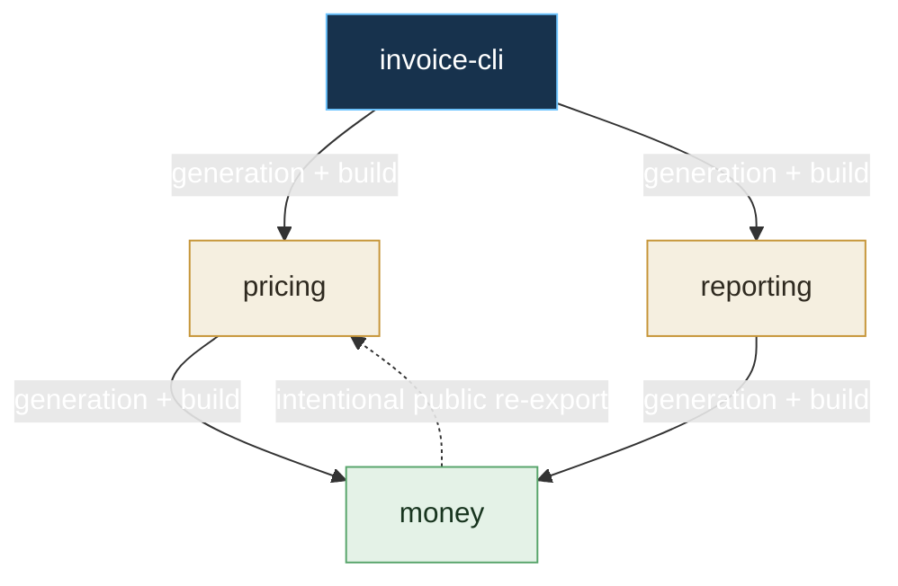

> Abstract: A four-node `invoice-cli` diamond demonstrates that private changes regenerate only the changed provider but rebuild and retest artifact consumers, public-interface changes propagate along direct generation edges and intentional re-exports, and asset changes skip regeneration while invalidating downstream builds and tests.

`invoice-cli` generates against the direct public interfaces of `pricing` and
`reporting`. Both depend directly on `money`. `pricing` intentionally re-exports the
`money` interface; `reporting` does not.

For this exact graph, build changes propagate through build edges and interface changes
propagate through direct generation edges. The re-export makes the `money` public
interface part of `pricing`'s public identity. A private `money` revision changes its
`ComponentInterfaceBinding`, but the bound interface identity remains unchanged.

| Change | Regenerate | Rebuild | Retest |
| --- | --- | --- | --- |
| `invoice-cli` local authority | `invoice-cli` | `invoice-cli` | `invoice-cli` |
| `pricing` private/local authority | `pricing` | `pricing`, `invoice-cli` | `pricing`, `invoice-cli` |
| `reporting` private/local authority | `reporting` | `reporting`, `invoice-cli` | `reporting`, `invoice-cli` |
| `money` private/local authority | `money` | `money`, `pricing`, `reporting`, `invoice-cli` | `money`, `pricing`, `reporting`, `invoice-cli` |
| `money` public interface, with the shown re-export | all four | all four | all four |
| `money` target or Flavor selection | `money` | all four | all four |
| `money` authored binary asset | none | all four | all four |

If neither direct consumer intentionally re-exported `money`, a `money` interface change
would regenerate `money`, `pricing`, and `reporting`, but not `invoice-cli`. The root
still rebuilds and retests because its dependency artifacts changed. The exact table is
also represented by the versioned `ComponentInvalidationTable` contract and enforced by
the diamond fixture test; it is not merely explanatory prose.

Source: [docs/decisions/0005-executable-component-semantics.md](https://github.com/jordanhubbard/literate-ai/blob/fcc40bc617a2bc2455627db7396a1e016ebfbab6/docs/decisions/0005-executable-component-semantics.md) at commit `fcc40bc` (source lines 118–159).
